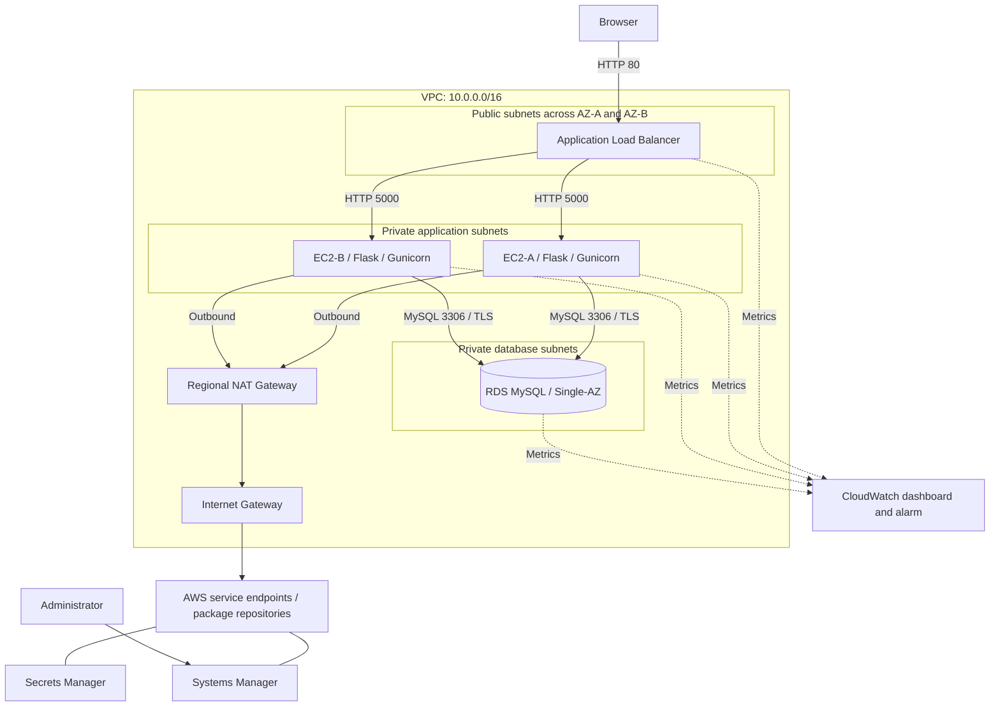
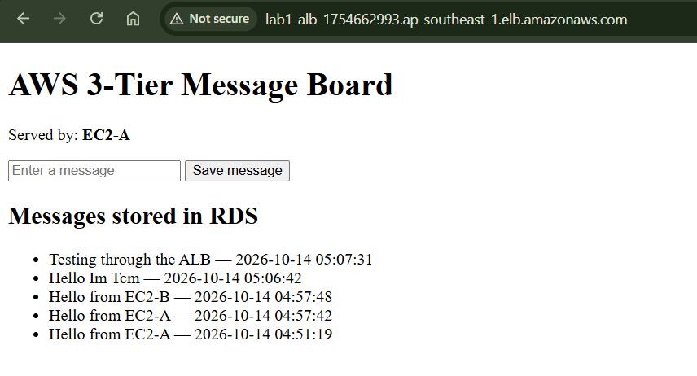
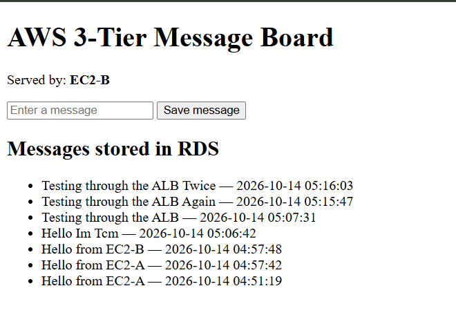
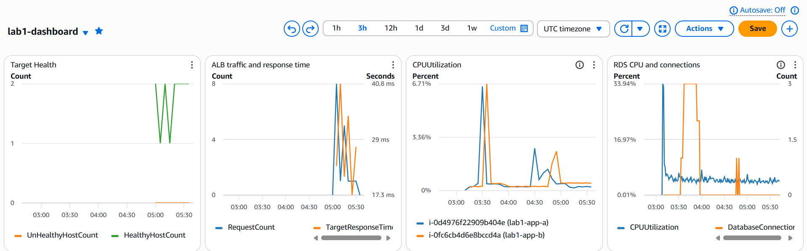
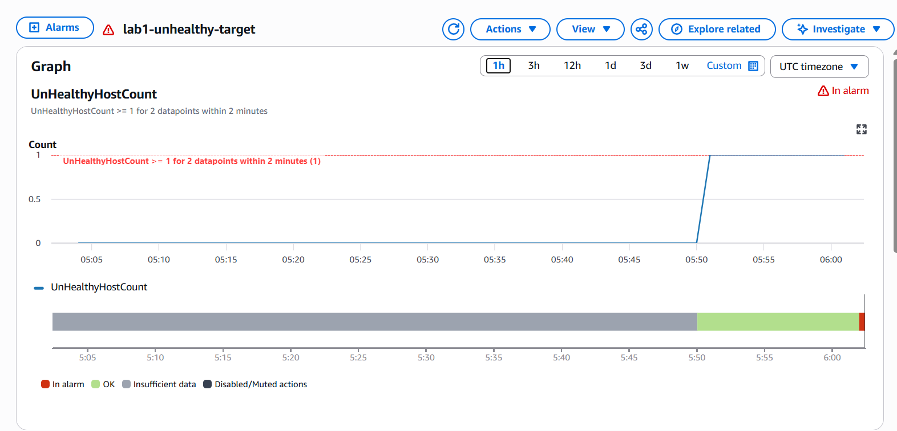
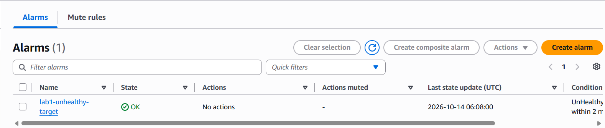

# Secure 3-Tier AWS Architecture

An AWS portfolio lab demonstrating a message-board application running on two private EC2 instances behind an internet-facing Application Load Balancer, with shared data stored in a private Amazon RDS MySQL database.

The infrastructure was configured manually using the AWS Management Console. The project covers network segmentation, security group references, IAM roles, database credentials in Secrets Manager, application deployment, failover testing, and CloudWatch monitoring.

## Project overview

| Component | Implementation |
|---|---|
| Region | Asia Pacific (Singapore), `ap-southeast-1` |
| Network | One VPC with public, application, and database subnets across two AZs |
| Entry point | Internet-facing Application Load Balancer |
| Application | Flask and Gunicorn on two private Amazon Linux 2023 EC2 instances |
| Database | Private, Single-AZ Amazon RDS for MySQL |
| Outbound access | Public Regional NAT Gateway |
| Instance administration | AWS Systems Manager Session Manager |
| Credentials | AWS Secrets Manager, retrieved using the EC2 IAM role |
| Monitoring | CloudWatch dashboard and an unhealthy-target alarm |
| Deployment | Manual Console configuration and shell commands |

## Architecture



The subnet group spans two database subnets, but the database itself is Single-AZ. Application availability across two AZs was tested; database failover was not tested. The diagram groups resources by network layer rather than showing the precise location of every service component.

## Network design

| Subnet | CIDR | Placement | Purpose |
|---|---|---|---|
| Public A | `10.0.1.0/24` | AZ-A | ALB network attachment |
| Public B | `10.0.2.0/24` | AZ-B | ALB network attachment |
| Private application A | `10.0.11.0/24` | AZ-A | EC2-A |
| Private application B | `10.0.12.0/24` | AZ-B | EC2-B |
| Private database A | `10.0.21.0/24` | AZ-A | RDS subnet group |
| Private database B | `10.0.22.0/24` | AZ-B | RDS subnet group |

Public subnets route internet traffic to the Internet Gateway. Application subnets route outbound IPv4 traffic to the Regional NAT Gateway. Database subnets have the VPC local route without an internet default route. A Regional NAT Gateway is a VPC-level resource and does not require placement in a public subnet.

## Security design

- Application instances have no public IP addresses.
- RDS public access is disabled.
- The application security group accepts TCP 5000 only from the ALB security group.
- The database security group accepts TCP 3306 only from the application security group.
- Session Manager provides instance administration without an inbound SSH rule or SSH key pair.
- The application retrieves credentials from Secrets Manager through its IAM role; credentials are not embedded in the application source.
- The database application account has `SELECT` and `INSERT` privileges on `labdb.messages`.
- Database connections use TLS with the Amazon RDS certificate bundle.
- SQL inserts use parameterized queries, and displayed messages use template escaping.

See [Security design](docs/security-design.md) for boundaries and limitations.

## Application behavior

| Route | Method | Purpose |
|---|---|---|
| `/` | GET | Display the message board and serving instance label |
| `/health` | GET | Return the application health status and instance label |
| `/messages` | GET | Read the latest 100 messages from RDS |
| `/messages` | POST | Insert a message and redirect to the home page |

Gunicorn listens on port 5000 and runs under a dedicated system account. A `systemd` service starts the application after an instance restart. Each database operation opens and closes its own connection.

## Verified results

| Test | Result |
|---|---|
| Browser access through the ALB | Passed |
| Reading and writing RDS messages | Passed |
| Both instances reading shared data | Passed |
| EC2-A stopped; EC2-B serving and saving messages | Passed after an initial 504 interruption |
| Application failure detected by CloudWatch | Passed |
| Application restored; alarm returned to OK | Passed |
| Both registered targets healthy after recovery | Passed |
| RDS Multi-AZ failover | Not tested; standby option unavailable in this lab configuration |
| HTTPS | Not configured |

Tests were performed on 14 October 2026. See [Test results](docs/test-results.md) for evidence and observed limitations.

### Message board through the ALB



### EC2-B serving after EC2-A was stopped



### CloudWatch dashboard



### Failure detection and recovery





## Monitoring

The dashboard contains target health, ALB request count and response time, CPU utilization for both EC2 instances, and RDS CPU utilization and database connections.

The alarm evaluates `UnHealthyHostCount` for the ALB and target group using **Maximum**, a **1-minute period**, and a threshold of **greater than or equal to 1 for 2 of 2 datapoints**. Missing data is treated as not breaching. No notification or automated remediation action is configured; the alarm was observed in the console.

## Reproduction and documentation

- [Deployment guide](docs/deployment.md)
- [Security design](docs/security-design.md)
- [Test results](docs/test-results.md)
- [Cleanup guide](docs/cleanup.md)

This repository documents the completed manual deployment and its test evidence. It does not contain Terraform or claim automated infrastructure provisioning. Deployed application source can be exported from the EC2 instance before cleanup using the instructions in the deployment guide.

## Cost decisions

The lab uses a Single-AZ database, HTTP access, basic metrics, one dashboard, and one standard alarm. A custom domain, HTTPS setup, advanced monitoring, and RDS Multi-AZ testing were deferred to preserve the learning budget.

ALB, NAT Gateway, EC2, RDS, storage, and Secrets Manager can incur charges or consume credits. Free allowances are account-wide and depend on eligibility and usage. The lab is intended to be documented and then removed, rather than left running as a permanent website.

## Lessons learned

- Private EC2 instances can be administered through Session Manager using an IAM role and outbound service connectivity.
- ALB targets must be registered with the application port and a functioning health-check path.
- A database instance name and an internal database name are different: `lab1-mysql` hosts `labdb`.
- The database user must exist and its password must match the secret used by the application.
- The application reads its secret at startup, so changing the secret requires restarting the service in this implementation.
- An alarm configured as `> 1` does not detect exactly one unhealthy target; `>= 1` is required for this test.
- A stopped instance can become `Unused`; stopping the application while leaving the instance running creates the unhealthy-target condition used by the alarm.
- Application failover can include an interruption during target failure detection; successful recovery does not imply zero downtime.

## Future improvements

- Rebuild the infrastructure using Terraform.
- Use an Auto Scaling Group and a launch template for application instances.
- Add an ACM certificate, custom DNS, and HTTP-to-HTTPS redirection.
- Enable and test RDS Multi-AZ when account capability and budget permit.
- Add database error handling and bounded retries for transient failures.
- Add credential refresh, rotation support, structured logs, and notifications.
- Add authentication, CSRF protection, and rate limiting before broader public use.

## Repository layout

```text
secure-3-tier-aws-architecture/
├── README.md
├── .gitignore
├── docs/
│   ├── deployment.md
│   ├── security-design.md
│   ├── test-results.md
│   └── cleanup.md
└── screenshots/
```
